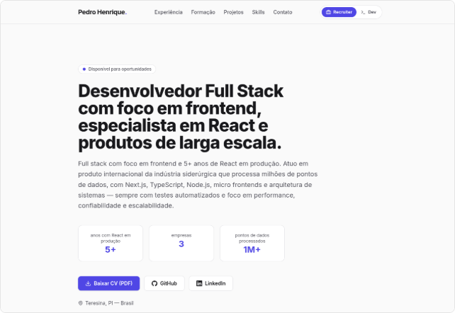
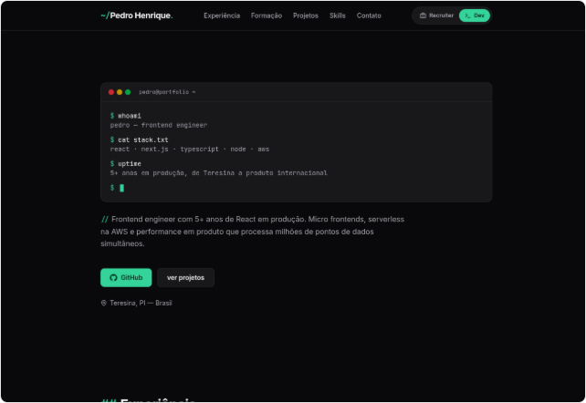

<div align="center">

# Pedro Henrique | Site Currículo

**Currículo interativo com dois modos de leitura: um para recrutadores, outro para devs.**

[](https://react.dev)
[](https://www.typescriptlang.org)
[](https://vite.dev)
[](https://tailwindcss.com)
[](https://github.com/phap9060/curriculum-site/actions/workflows/deploy.yml)

**[Acessar o site publicado](https://phap9060.github.io/curriculum-site/)**

[Preview](#preview) · [Stack](#stack) · [Rodando localmente](#rodando-localmente) · [Conteúdo](#editando-o-conteúdo) · [Estrutura](#estrutura-do-projeto)

</div>

---

## Sobre o projeto

Um site pessoal que funciona como currículo, mas com uma proposta diferente: em vez
de uma única página genérica, ele oferece **duas experiências de leitura** para o
mesmo perfil, alternáveis por um toggle no topo.

| Modo | Tema | O que mostra |
|---|---|---|
| **Recruiter** (padrão) | Sóbrio, estilo currículo (branco, bordas finas) | Impacto, resultados, métricas e download do CV em PDF |
| **Dev** | Colorido: "Quem é esse dev?" + aparelho DEV-DEX | Stack, arquitetura, decisões técnicas, stats e terminal |

Idioma e modo ficam na **query string**, então qualquer combinação pode ser
compartilhada por link (sem parâmetros vale o padrão, inglês + recruiter):

| URL | Idioma | Modo |
|---|---|---|
| `/` | EN | Recruiter |
| `/?lg=pt` | PT | Recruiter |
| `/?mode=dev` | EN | Dev |
| `/?lg=pt&mode=dev` | PT | Dev |

 A troca não muda só as cores: **o conteúdo, a organização e a linguagem de
cada seção também mudam**: cada bloco de dados tem uma versão `recruiter` e uma
versão `dev`.

## Preview

| **Modo Recruiter** | **Modo Dev** |
|:---:|:---:|
| [](docs/screenshots/modo-recruiter.png) | [](docs/screenshots/modo-dev.png) |

> Clique nas imagens para abrir a captura completa da página.

## Stack

- **React 19** + **TypeScript** + **Vite**
- **Tailwind CSS 4** com design tokens semânticos via CSS custom properties
- **lucide-react** para ícones (os ícones de marca GitHub/LinkedIn são SVGs próprios)
- ESLint + `typescript-eslint`

Sem framework de UI, sem biblioteca de animação, sem estado global além do contexto
de modo. A ideia é manter o projeto pequeno e fácil de manter.

## Rodando localmente

Pré-requisitos: **Node.js 20+** e npm.

```bash
npm install
npm run dev      # http://localhost:5173
```

Outros scripts:

```bash
npm run build    # type-check + build de produção em dist/
npm run preview  # serve o build de produção localmente
npm run lint     # roda o ESLint
```

> **Nota:** o TypeScript está fixado em `~5.9` de propósito. O template original
> vinha com TS 7, que o `typescript-eslint` ainda não suporta, e isso quebrava o
> `npm install` e o `npm run lint`.

## Editando o conteúdo

Todo o conteúdo do site vive em `src/data/`, com um arquivo por idioma:

```
src/data/profile.pt.ts   # português
src/data/profile.en.ts   # inglês
src/data/profile.ts      # nome e links (independem do idioma)
```

Nome, contatos, headline, experiências, formação, projetos e skills: cada bloco tem
uma versão `recruiter` e uma versão `dev`. Os dois arquivos seguem a mesma estrutura
(`Profile`, em `types.ts`); ao editar um, replique a mudança no outro. O visitante troca
o idioma pelo seletor **PT / EN** no cabeçalho (o idioma vai para a URL como `?lg=pt`;
o padrão é inglês). Não há texto de perfil hardcoded nos componentes.

### Currículo em PDF

O botão **"Baixar CV (PDF)"** baixa `public/cv-pt.pdf` ou `public/cv-en.pdf`, conforme o
idioma ativo. Para atualizar o CV, basta substituir esses arquivos.

## Estrutura do projeto

```
├── docs/
│   ├── UI.md                     # Diretrizes de UI (design system)
│   └── screenshots/              # Capturas usadas neste README
├── public/
│   ├── cv-pt.pdf                 # CV em português (botão do hero)
│   ├── cv-en.pdf                 # CV em inglês
│   ├── favicon.svg
│   └── icons.svg
└── src/
    ├── components/
    │   ├── layout/               # Header, Footer
    │   └── ui/                   # Badge, Mascot, ModeToggle, LangToggle, icons
    ├── context/
    │   ├── mode-context.ts       # createContext + tipo Mode
    │   ├── ModeProvider.tsx      # modo vindo da URL (?mode=dev), classe .dark
    │   ├── lang-context.ts       # createContext do idioma
    │   └── LangProvider.tsx      # idioma vindo da URL (?lg=pt)
    ├── hooks/
    │   ├── useMode.ts            # acesso ao contexto de modo
    │   └── useLang.ts            # idioma ativo + conteúdo traduzido
    ├── data/
    │   ├── profile.pt.ts         # ★ conteúdo em português
    │   ├── profile.en.ts         # ★ conteúdo em inglês
    │   ├── profile.ts            # identidade + mapa de idiomas
    │   └── types.ts              # tipos do conteúdo
    ├── sections/
    │   ├── RecruiterPage.tsx     # modo recruiter: página minimalista de texto
    │   ├── Hero.tsx              # modo dev: silhueta + aparelho DEV-DEX
    │   └── dex/DexPanels.tsx     # abas do DEV-DEX (info, stats, evolução, golpes...)
    ├── lib/
    │   ├── cn.ts                 # helper de classes condicionais
    │   └── route.ts              # idioma/modo na query string (?lg, ?mode)
    ├── App.tsx                   # composição das seções
    ├── main.tsx
    └── index.css                 # Tailwind + design tokens (temas dos modos)
```

### Convenções

- **Componentes de UI** (`components/ui`) são genéricos e não conhecem o conteúdo do
  perfil.
- **Seções** (`sections`) compõem os componentes de UI com os dados do idioma ativo
  (`useLang()`) e decidem o que mostrar em cada modo via `useMode()`.
- **Cores nunca são fixas**: use os tokens semânticos (`bg-surface`, `text-ink`,
  `text-accent`...). As diretrizes completas estão em [docs/UI.md](docs/UI.md).

## Como funcionam os temas

`src/index.css` define CSS custom properties em `:root` (modo recruiter, claro) e
`.dark` (modo dev, escuro). O `ModeProvider` alterna a classe `.dark` no `<html>`
conforme o modo ativo, e os tokens semânticos do Tailwind (`bg-surface`, `text-ink`,
`bg-accent`...) reagem automaticamente. Nenhum componente precisa saber qual tema está
ativo, só qual modo (`useMode()`).

## Build e deploy

O deploy é automático: cada push na branch `main` dispara o workflow
[`.github/workflows/deploy.yml`](.github/workflows/deploy.yml), que roda o build e
publica o resultado no **GitHub Pages**.

- **Site:** https://phap9060.github.io/curriculum-site/
- **Actions:** https://github.com/phap9060/curriculum-site/actions

O resultado de `npm run build` também é um site estático na pasta `dist/`, pronto
para qualquer hospedagem estática (Vercel, Netlify, S3 etc.), sem necessidade de
servidor.

---

<div align="center">

Feito por **Pedro Henrique** · [LinkedIn](https://linkedin.com/in/phap9060) · [GitHub](https://github.com/phap9060)

</div>
